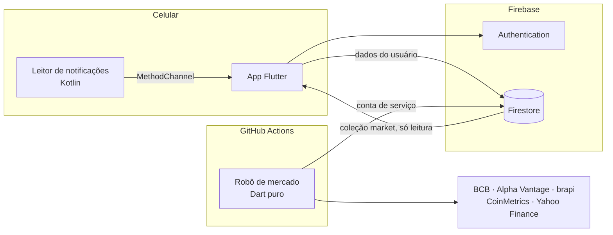

<div align="center">


# ControlFin

**Finanças pessoais com orçamento, cartões de crédito e uma carteira de investimentos montada a partir da teoria financeira.**


</div>

---

O ControlFin é um app em pt-BR que junta, num lugar só, o controle do mês e o
planejamento dos investimentos. O usuário registra ganhos e gastos (à mão,
importando a fatura ou a partir das notificações do banco), acompanha as metas
do orçamento e recebe uma orientação clara de como dividir o próximo salário
entre a reserva de emergência e a carteira de investimentos.

## Sumário

- [Funcionalidades](#funcionalidades)
- [Arquitetura](#arquitetura)
- [Modelos financeiros](#modelos-financeiros)
- [Privacidade e segurança](#privacidade-e-segurança)
- [Como rodar](#como-rodar)
- [Robô de dados de mercado](#robô-de-dados-de-mercado)
- [Testes e qualidade](#testes-e-qualidade)
- [Estrutura do projeto](#estrutura-do-projeto)
- [Aviso](#aviso)
- [Licença](#licença)

## Funcionalidades

### Orçamento do mês
- **Lançamentos** de ganhos e gastos, com sugestão automática de categoria pela descrição.
- **Lançamentos únicos, mensais ou parcelados.** Uma compra parcelada é uma compra só: editar uma parcela atualiza todas.
- **Metas no estilo 50/30/20**, com categorias e tipos de gasto personalizáveis (cor e meta em que cada tipo entra).
- **Reserva de emergência** calculada pela média dos gastos essenciais dos últimos meses.
- **Filtros** por meta, cartão, débito/Pix ou crédito, a partir de um toque no resumo.

### Cartões de crédito e faturas
- Cadastro de cartões com dia de fechamento e vencimento. A compra no crédito conta no mês em que a fatura vence, para o saldo bater com o dinheiro que sai da conta.
- **Importação de fatura em PDF ou CSV** (Nubank e outros formatos comuns): reconhece o banco, o cartão, o vencimento e as parcelas, confere o total e marca os lançamentos repetidos.

### Notificações dos bancos (Android)
- Lê as notificações dos apps de banco e propõe o lançamento: o usuário só confere a categoria e confirma.
- Compras canceladas anulam a compra correspondente. Códigos de verificação e propagandas são descartados.
- O texto das notificações **não sai do celular** (veja [Privacidade](#privacidade-e-segurança)).

### Investimentos
- **Perfil de investidor** por questionário, separando disposição e capacidade de assumir risco.
- **Divisão do próximo salário**: quanto vai para a reserva e quanto para cada classe de ativo, considerando a carteira atual. A divisão só compra, nunca manda vender.
- **Carteira-alvo** por otimização de média-variância, com fronteira eficiente.
- **Ações para a sua carteira**: avalia as ações que o usuário já tem (reforçar, manter ou não aumentar) e sugere outras que oscilam de forma diferente.

### Comunidade
- Envio de problemas e sugestões direto do app, com acompanhamento do status e da resposta.

## Arquitetura



- **O app não tem nenhuma chave de API.** Um robô em Dart puro roda no GitHub Actions (completo uma vez por dia e rápido quatro vezes durante o pregão), coleta os dados de mercado e grava na coleção `market`. O app só lê essa coleção.
- **Sem backend próprio:** os dados de cada usuário ficam em `users/{uid}` no Firestore, protegidos pelas regras de segurança.
- **Estado simples:** `StatefulWidget` + `StreamBuilder` sobre os streams do Firestore, sem bibliotecas de gerência de estado.
- **Cálculo pesado fora da interface:** a otimização da carteira roda em `compute`, num isolate separado.

## Modelos financeiros

| Tema | Modelo | Onde é usado |
|---|---|---|
| Perfil de risco | Bernoulli e von Neumann–Morgenstern (utilidade esperada), aversão ao risco de Arrow–Pratt, ciclo de vida de Modigliani–Brumberg | Questionário e coeficiente de aversão ao risco (γ) |
| Carteira | Média-variância de Markowitz (1952), com encolhimento da covariância | Carteira-alvo e fronteira eficiente |
| Retorno esperado | CAPM com prêmio de risco de mercado e risco-país de Damodaran; prêmios de Fama–French | Premissas de retorno por classe |
| Preço justo | Gordon–Shapiro (dividendos) e Benjamin Graham (√22,5 × LPA × VPA) | Ranking e recomendação de ações |
| Bitcoin | Lei de Metcalfe (efeito de rede); stock-to-flow só como informação | Limite de exposição |

As premissas (fontes e datas) ficam em `Assumptions`, em `lib/models/market/portfolio_engine.dart`.

## Privacidade e segurança

- **Isolamento por usuário:** cada pessoa lê e grava só os próprios dados (`users/{uid}/**`), garantido pelas regras do Firestore.
- **Chaves de API fora do app e do repositório:** ficam nos *Secrets* do GitHub, usados apenas pelo robô.
- **Notificações dos bancos:** o texto original fica só no aparelho. Para o Firestore vai apenas o lançamento que o usuário confirmou. Formatos que o leitor ainda não reconhece podem ser enviados para revisão **com os dados trocados** (valores, datas, números e nomes de pessoas) antes de sair do celular.
- **Backup do Android desativado**, para que a fila local de notificações não vá para backups em nuvem.

Encontrou uma falha de segurança? Não abra uma *issue* pública: use o
[relato privado de vulnerabilidade](../../security/advisories/new) do GitHub.

## Como rodar

### Pré-requisitos
- [Flutter](https://docs.flutter.dev/get-started/install) 3.47 ou mais novo (canal stable)
- Um projeto no [Firebase](https://console.firebase.google.com) (o plano gratuito basta)
- Para Android: Android SDK e JDK 17 ou mais novo

### 1. Configurar o Firebase

1. Em **Authentication → Sign-in method**, ative **E-mail/senha** e **Google**.
2. Crie o **Firestore Database** em modo produção.
3. Gere a configuração do app (cria `lib/firebase_options.dart` e `android/app/google-services.json`):
   ```bash
   dart pub global activate flutterfire_cli
   flutterfire configure --platforms=android,web
   ```
4. **Android:** cadastre os SHA-1 e SHA-256 da sua chave de assinatura no Firebase (`cd android && ./gradlew signingReport`), senão o login com Google não funciona.
5. **Web:** em Authentication → Settings → Authorized domains, adicione o domínio onde o app vai rodar.

### 2. Publicar as regras do Firestore

Em **Firestore → Regras**, publique o conjunto abaixo. Troque `UID_DO_DESENVOLVEDOR` pelo UID da conta que administra os reports e a revisão de notificações. Os blocos completos dessas duas coleções são gerados pelo próprio app (`reportsRules` e `samplesRules`) e aparecem na área do desenvolvedor.

```
rules_version = '2';
service cloud.firestore {
  match /databases/{database}/documents {
    // Dados de cada usuário: só o dono.
    match /users/{uid}/{document=**} {
      allow read, write: if request.auth != null && request.auth.uid == uid;
    }
    // Dados de mercado: gravados só pelo robô (conta de serviço).
    match /market/{doc} {
      allow read: if request.auth != null;
      allow write: if false;
    }
    // community_reports e notification_samples:
    // cole aqui os blocos de reportsRules() e samplesRules().
  }
}
```

### 3. Executar

```bash
flutter pub get
flutter run -d chrome              # web
flutter run                        # Android (dispositivo ou emulador)
flutter build apk --release        # APK de release
```

Para assinar o APK de release, crie `android/key.properties` (fora do controle de versão) apontando para o seu keystore.

## Robô de dados de mercado

O workflow [`.github/workflows/market.yml`](.github/workflows/market.yml) roda `tool/update_market.dart`:

| Modo | Quando (horário de Brasília) | O que coleta |
|---|---|---|
| Completo | Todo dia às 18h30 | Selic, IPCA, Focus, dólar, juros dos EUA, séries dos ETFs, Bitcoin, ações e cotações |
| Rápido | 11h, 13h, 15h e 17h, de segunda a sexta | Cotações, Ibovespa e preço das ações (sem Alpha Vantage, por causa da cota diária) |

**Secrets necessários** (Settings → Secrets and variables → Actions):

| Secret | Para quê |
|---|---|
| `ALPHA_VANTAGE_KEY` | Séries mensais dos ETFs, dólar e juros dos EUA ([chave gratuita](https://www.alphavantage.co/support/#api-key)) |
| `BRAPI_TOKEN` | Cotações e valor de mercado da B3 ([brapi.dev](https://brapi.dev)) |
| `FIREBASE_SERVICE_ACCOUNT` | JSON de uma conta de serviço com acesso ao Firestore |

Para rodar no computador, copie `tool/env.example.json` para `tool/env.json` (ignorado pelo git) e preencha as chaves:

```bash
DRY_RUN=1 dart run tool/update_market.dart --env tool/env.json          # só coleta e mostra
DRY_RUN=1 dart run tool/update_market.dart --env tool/env.json --quick  # modo rápido
```

O robô roda sem Flutter. Por isso, `lib/models/market/`, `lib/services/market/market_sources.dart` e `market_collector.dart` precisam continuar em Dart puro.

## Testes e qualidade

```bash
dart analyze    # sem nenhum aviso
flutter test    # 155 testes
```

Os testes cobrem as regras de negócio (séries e parcelas, faturas e cartões, importação de PDF/CSV, leitura e anonimização de notificações, perfil de investidor, otimização da carteira, recomendação de ações) e as principais telas, com os serviços do Firebase substituídos por dados de teste.

## Estrutura do projeto

```
lib/
  models/            regras de negócio (lançamentos, metas, cartões, perfil, notificações)
  models/market/     dados de mercado e motor da carteira (Dart puro)
  services/          Firestore, autenticação, importação de faturas, notificações
  services/market/   fontes de dados e coletor (robô) e leitura no app
  pages/             telas
  widgets/           componentes das telas
android/             app Android e leitor de notificações em Kotlin
tool/                robô de dados de mercado
test/                testes de unidade e de widget
```

## Aviso

O ControlFin é um projeto pessoal e educacional. As sugestões de carteira e de
ações são calculadas automaticamente a partir de dados públicos e de modelos
acadêmicos, podem conter erros ou dados desatualizados e **não constituem
recomendação de investimento**. Antes de investir, avalie com cuidado ou consulte
um profissional certificado.

O pacote [`syncfusion_flutter_pdf`](https://pub.dev/packages/syncfusion_flutter_pdf)
exige uma licença Syncfusion válida, que pode ser a
[Community License](https://www.syncfusion.com/products/communitylicense) gratuita.

## Licença

Copyright © 2026 Leandro Santana Martins. Todos os direitos reservados.

O código está disponível publicamente apenas para consulta. Não é permitido
copiar, modificar, distribuir ou usar este código, no todo ou em parte, sem
autorização prévia e por escrito do autor. Veja [LICENSE](LICENSE).
